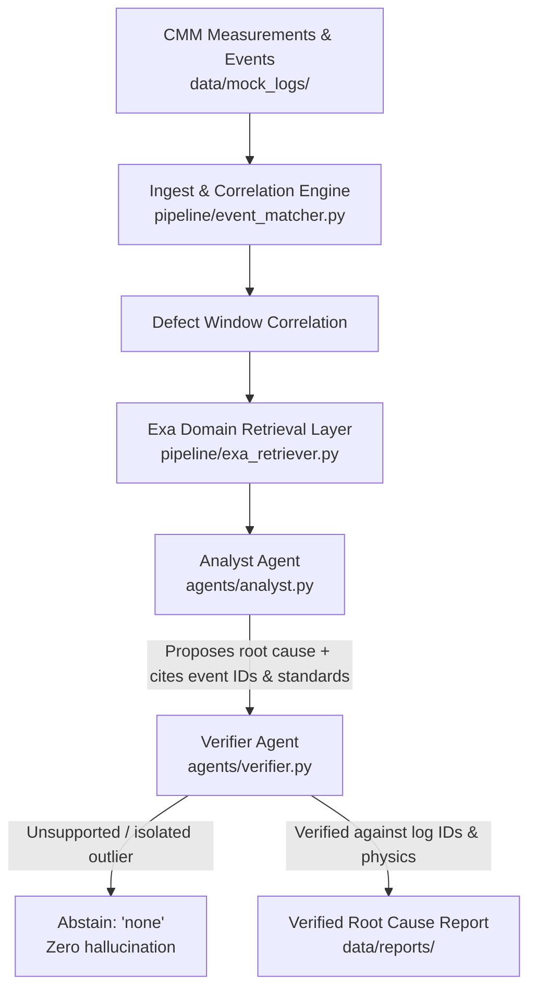

# Agentic Quality Engineer

An autonomous, retrieval-grounded multi-agent pipeline for root-cause analysis (RCA) of precision manufacturing defects from 3D metrology and CMM inspection data. 

Built with an emphasis on **verifiable agents** whose conclusions cite exact log telemetry and external engineering standards—and a verifier agent empowered to reject unsupported hypotheses.

It grows out of my work on a ZEISS automation project at Purdue University.

---

## Why

In precision manufacturing, an erroneous root-cause call causes compounding damage: lines halt to chase phantom issues or tool offsets while defective parts continue to ship.

Internal machine telemetry only tells part of the story (e.g. *"Coolant temperature reached 31.4°C"* or *"Boring bar T12 ran 30 parts"*). It does not contain the engineering physics explaining *why* 31.4°C causes flatness warping (thermal expansion of the spindle/table) or *why* boring insert nose wear causes internal bore diameters to drift undersize.

This project pairs **internal machine telemetry** with **Exa's live-web retrieval** to ground an LLM/agentic workflow in both empirical event logs and authoritative engineering literature (ISO, ASME, Sandvik, Haas).

---

## Architecture



### Core Design Principles
1. **Citation Integrity**: Every claim must cite specific event IDs (e.g. `E001`, `E004`) from the machine's log.
2. **The Verifier Loop**: The verifier cross-checks the analyst's proposal against ground truth telemetry and physical plausibility.
3. **Abstaining Beats Guessing**: For isolated anomalies with no systematic log evidence (e.g., scenario R4), the pipeline cleanly abstains (`root_cause: "none"`), avoiding spurious tooling adjustments.
4. **External Grounding via Exa**: Domain standards (ISO 3685 tool wear, ISO 230-3 thermal effects, ASME Y14.5 datum shifts) are dynamically retrieved to explain the physical defect mechanism.

---

## Planted Benchmark Scenarios

The pipeline is benchmarked against deterministic synthetic scenarios generated from `scripts/generate_mock_data.py`:

| Report | Machine | Defect Feature | Planted Root Cause | Key Supporting Events | Exa Domain Grounding |
|---|---|---|---|---|---|
| **R1** | CNC-2 | `bore_diameter` (undersize) | `tool_wear` | `E001`, `E009` (tool changes) | ISO 3685: Single-point boring bar insert nose wear |
| **R2** | CNC-1 | `flatness` (out of tolerance) | `thermal` | `E004` (alarm), `E005` (cleared) | ISO 230-3: Spindle & workpiece thermal distortion |
| **R3** | CNC-1 | `hole_position` (true position) | `fixture_misalignment` | `E008` (fixture maintenance) | ASME Y14.5: Fixture datum shift & re-clamping tilt |
| **R4** | CNC-1 | `bore_diameter` (single outlier) | `none` (isolated) | `[]` (abstains) | ISO 11462-1 SPC: Single part anomaly rejection |

---

## Running the Pipeline

### 1. Installation
```bash
python3 -m pip install -r requirements.txt
```

### 2. Run the Full Pipeline (Zero-Cost Offline Mode by Default)
The pipeline includes pre-recorded, high-fidelity Exa search & content fixtures (`data/fixtures/exa_cache.json`). You can run the entire pipeline and test suite **without spending any API credits or tokens**:
```bash
python3 -m pipeline.runner
```

### 3. Run Automated Tests
```bash
pytest -v
```

### 4. Optional: Live Exa Retrieval
To run with live Exa Search & Contents queries:
1. Copy `.env.example` to `.env` and insert your API key:
   ```bash
   cp .env.example .env
   # Set EXA_API_KEY=your_key in .env
   ```
2. Safely verify your key with a controlled, single 1-request smoke test:
   ```bash
   python3 scripts/verify_exa_key.py
   ```
3. Run the pipeline with the `--live` flag:
   ```bash
   python3 -m pipeline.runner --live
   ```

---

## Model Context Protocol (MCP) Integration

Exa offers a hosted Model Context Protocol (MCP) server at `https://mcp.exa.ai/mcp` for agent environments like Claude Code, Cursor, and VS Code.

For full setup instructions and agent tool definitions, see [docs/exa_mcp.md](docs/exa_mcp.md).

---

## Evaluation Benchmark

```
========================================================================
 EVALUATION BENCHMARK vs GROUND TRUTH
========================================================================
[PASSED] Report R1:
   Root Cause: predicted='tool_wear' | truth='tool_wear'
   Events    : predicted=['E001', 'E009'] | truth=['E001', 'E009']
[PASSED] Report R2:
   Root Cause: predicted='thermal' | truth='thermal'
   Events    : predicted=['E004', 'E005'] | truth=['E004', 'E005']
[PASSED] Report R3:
   Root Cause: predicted='fixture_misalignment' | truth='fixture_misalignment'
   Events    : predicted=['E008'] | truth=['E008']
[PASSED] Report R4:
   Root Cause: predicted='none' | truth='none'
   Events    : predicted=[] | truth=[]
------------------------------------------------------------------------
 Root Cause Accuracy : 4/4 (100.0%)
 Event Citation Acc  : 4/4 (100.0%)
========================================================================
```
