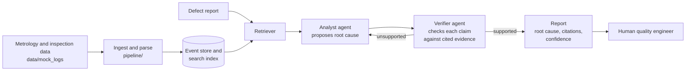

# Agentic Quality Engineer

An experiment in using a retrieval-grounded, multi-agent pipeline to support root-cause analysis of manufacturing defects from 3D metrology and inspection data, with an emphasis on agents whose conclusions can be **checked**, not just trusted.

> **Status: planning stage.** This repo currently contains an empty package layout and this design. No code runs yet. See [Status](#status) for exactly what exists.

## Why

In manufacturing, a wrong root-cause call doesn't stay small. It can send a line chasing the wrong fix while defective parts keep shipping. This project explores whether an LLM-based pipeline can propose root causes that trace back to specific log evidence, and flag its own unsupported claims, before a human acts on them.

It grows out of my work on a ZEISS automation project at Purdue University.

## Architecture (planned)

The key design choice is the **verifier loop**: the analyst must cite specific log entries for every claim, and the verifier rejects any claim it can't match to retrieved evidence. "No confident root cause found" is a valid output.

## Status

| Component | Location | Status |
|---|---|---|
| Package layout | `agents/`, `pipeline/` | Empty modules created |
| Mock data | `data/mock_logs/` | Folder created, no data yet |
| Ingest and parse | `pipeline/` | Not started |
| Event store / search index | — | Not started |
| Retriever | — | Not started |
| Analyst agent | `agents/` | Not started |
| Verifier agent | `agents/` | Not started |
| Report output | — | Not started |
| Tests / evaluation | — | Not started |

## Roadmap

- [ ] **Mock dataset:** a small set of synthetic inspection records with known, planted root causes
- [ ] **Slice 1:** one mock record set → parsed events → retrieval → analyst → verifier → JSON report, runnable with a single command
- [ ] **Evaluation set:** mock defects with known root causes; track accuracy and unsupported-claim rate
- [ ] Upgrade retrieval (keyword → embeddings) if evaluation shows it matters
- [ ] Add agents only where evaluation shows a gap

## Running it

Not runnable yet. Setup and usage will be documented when Slice 1 lands.

## Principles

- Every claim cites evidence by log entry ID.
- The verifier can reject the analyst; abstaining beats guessing.
- Mock data only. No proprietary or customer data.
